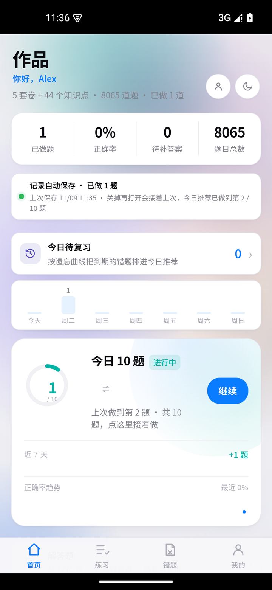
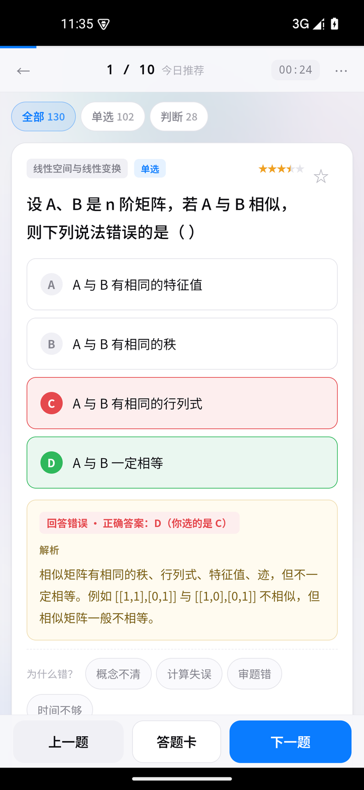
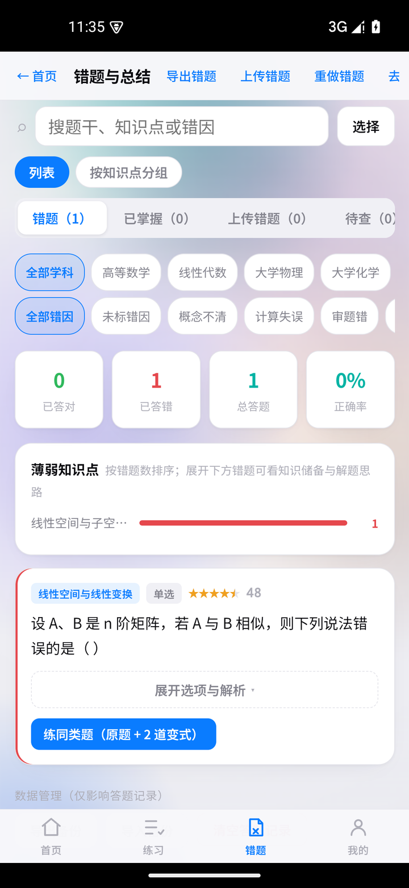
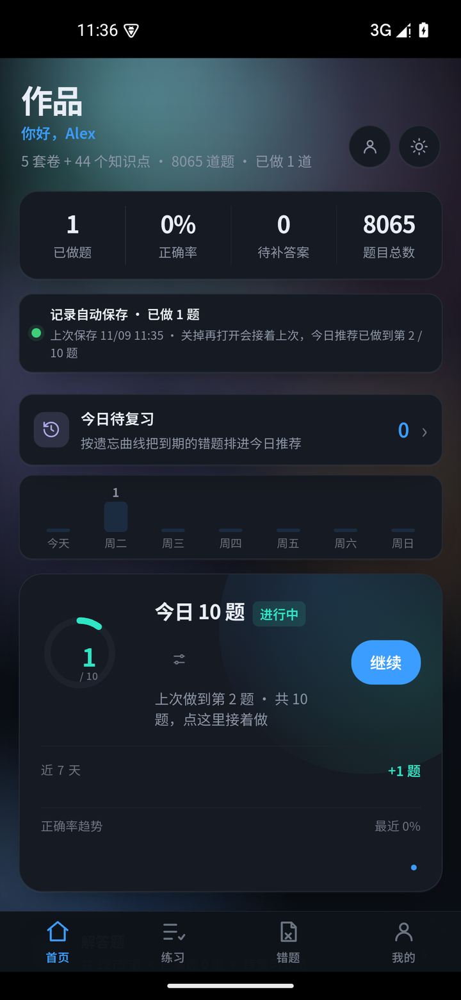

# 作品 · 大学理科练习

一个**不注册账号、不上传学习数据**的大学理科刷题工具。

题库 → 智能组卷 → 判分 → 错题诊断 → AI 讲解，全流程闭环，可完全离线运行。
桌面浏览器、安卓 APK、单文件 HTML —— 同一份代码，三种形态。

<p align="center">
  
  
  
</p>
<p align="center">
  
  
  <br>
  <sub>同一套结构，两套皮肤；知识点按薄弱优先排序</sub>
</p>

---

## 为什么做这个

大学理科有个很具体的困境：

- 作业交上去没人批，错在哪不知道
- 课后习题卡住了，晚上十点找不到人问
- 期末突击刷题，但**刷过的题不记得为什么错**，下次还是错

市面上的工具解决不了这三点：K12 产品不覆盖大学内容；通用 AI 能解题但不管理你的错题和薄弱点；而在意的另一点是——**没人愿意为了刷个题把手机号、学校、学习记录全交出去**。

所以这个项目的取舍从一开始就很明确：**本地优先，数据不出设备**。没有账号系统，没有云端同步，没有埋点。学习记录存在你自己设备的 localStorage 里，AI Key 由你自己填（或者构建时内嵌到只有你能拿到的安装包里）。

## 它是什么，不是什么

| 是 | 不是 |
|---|---|
| 一个完整的学习闭环（组卷 → 判分 → 诊断 → 复习） | 不是题库规模战 —— 只有 **8065 道**，5 套卷 / 44 个知识点 |
| 一个本地优先的工具 | 不是云平台 —— 无账号、无同步、无排行榜 |
| 一份可以读、可以改、可以自己加题库的代码 | 不是商业产品 —— 没有会员、没有广告位 |

## 功能

**今日十题**：按「遗忘曲线到期」+「薄弱知识点权重」+「冷门度」三者加权抽题。支持按学科筛选（比如只刷高数和线代）。中途退出再进来会接着上次做，队列和进度一起持久化。

**答题与详解**：即时判分、逐步解析、考点剖析、变式题。公式全部走 KaTeX 排版，长公式在窄屏可横向滑动。

**错题本**：默认折叠以便一屏看多题；可按知识点/搜索筛选；支持多选精练；能拍照上传纸质错题。

**解答题**：与选择题分开，不进判分链路——先给题干，点「展开解法」看分步推导，再按「不熟练 / 完全掌握」自评。内置精选 20 道 + 四套模拟卷的解答题（A/B/C/D 各 5 道）+ 题库 1255 道，任一步都可以点「问这一步」让 AI 换种讲法。

**拍照解题**：WebView `getUserMedia` 取景 → 点按对焦 / 双指缩放 → 框选题目区域 → AI 识别并生成详解。相机走的是静态照片通道（`ImageCapture`），不是视频帧截图，清晰度接近系统相机。

**掌握度与周报**：按知识点统计正确率、生成学习画像。

**全自动保存**：答一题存一次，杀进程、换设备都不会丢进度。

## 快速开始

### 方式零：在线直接试

**<https://lovecxyforever.github.io/college-science-practice/>**

不用装任何东西，浏览器打开就能做题。学习记录存在你自己的浏览器里，不上传。

### 方式一：本地跑（最简单）

```bash
git clone <this-repo>
cd 作品
# 用任意静态服务器打开（不要直接双击 index.html，file:// 下记录容易丢）
python -m http.server 8080
```

浏览器访问 `http://localhost:8080`。

Windows 用户也可以直接双击 `启动.bat`（会自动检测 Python 并起服务）。

### 方式二：单文件离线版

```bash
node scripts/build-singlefile.js
```

生成 `dist/作品-手机版.html`：所有脚本、样式、20 个字体、图标全部内联进一个文件，拷到任何设备双击就能用。

### 方式三：安卓 APK

APK 构建需要本地 Android SDK（`aapt2` / `d8` / `apksigner`），不在仓库里。步骤见 [docs/BUILD.md](docs/BUILD.md)。

## 配置 AI

拍照解题和详解生成需要一个 OpenAI 兼容的模型服务（默认 DeepSeek）。

两种填法：

1. **运行时填**：「我的 → AI 生成详解」里填 Base URL / 模型名 / API Key。Key 只存在本机 localStorage，只发给你填的服务地址。
2. **构建时内嵌**：

   ```bash
   # 方式一：写进 ai_default.local.json（已 gitignore）
   node scripts/gen-ai-default.js
   # 方式二：临时用环境变量
   AI_KEY=sk-xxx node scripts/gen-ai-default.js
   ```

   生成 `ai_default.js` 后打进安装包，安装即用。

> ⚠️ `ai_default.js` 已在 `.gitignore` 里。**不要把内嵌了 Key 的 APK 分发给别人**。

## 架构

```
作品/
├── index.html            单页骨架（10067 行，含 HTML 结构与业务脚本）
├── app.css               全部样式（1968 行，按功能分区注释）
├── papers_core.js        卷子与题目定义
├── papers_extra.js       补充卷子
├── bank.json             题库索引（2.5MB，构建产物，优先加载）
├── bank.js / bank_extra.js  题库原始定义（fallback 与单文件版使用）
├── knowledge.js          知识点库
├── solutions*.js         详解（按题型分片，延后加载）
├── practice.js           练习交互
├── sw.js                 Service Worker（PWA 离线）
├── vendor/               KaTeX
├── icons/
└── scripts/              构建脚本
```

数据流和关键设计决策见 [docs/ARCHITECTURE.md](docs/ARCHITECTURE.md)。

**为什么是原生 JS 而不是框架？**

这个项目最终要能塞进一个 6MB 的单文件 HTML 里，还要在 WebView 83（Android 11 时代）上跑起来。引入 React/Vue 意味着多 100KB+ 的运行时和一层构建抽象，而这里的 UI 主要是「状态变了重渲染一段 DOM」——手写 `render*` 函数反而更可控、更容易定位性能问题。

这是个**有意的取舍，不是技术债**。代价是状态管理靠全局变量（144 个），换来的是零依赖、零构建、单文件可分发。

## 工程笔记：几个真实踩过的坑

这部分是这个项目里唯一无法从文档抄到的东西。

### 1. 3MB 题库解析把主线程卡死 → ANR

题库最初是 `bank.js` 里一个 3.08MB 的 JS 对象字面量，用 `<script>` 动态插入加载。在 Android 11 / WebView 83 上，解析这个字面量要好几秒，期间主线程完全冻结，用户点一下就是「应用无响应」。

```
ANR in com.zuopin.app
Waited 5016ms for MotionEvent (540,1580)
```

修法是把题库预生成为 JSON，运行时用 `JSON.parse` 解析——原生实现，实测 **19–55ms**，比解析 JS 字面量快两个数量级。

**但这里有个坑**：APK 里页面是 `file://` 协议，Chromium 的 `fetch()` 走网络栈，**不支持 file:// scheme**。第一次改成 `fetch("bank.json")` 时看起来正常，实际上静默失败了，回落到老路径，等于没修。必须用 `XMLHttpRequest`（`file://` 下 `status === 0`，要按「有 responseText」判断成功）。

### 2. 拍照比系统相机糊很多

诊断下来是三层浪费叠加：

| 环节 | 问题 |
|---|---|
| `getUserMedia` | 写死 `ideal 1920x1440`。ideal 只是「尽量」，设备可能退到 720p |
| 拍照 | `MAX=1600`，把 938×1856 压成 808×1600 |
| 框选确认 | **又一道** `MAX=1600`，同一次拍照被降采样两次 |

修法：约束拉到 `ideal 4096` + 拿到流后按 `getCapabilities()` 的上限 `applyConstraints` 强制提一次；去掉两道 1600 限制；拍照改走 `ImageCapture.takePhoto()` 拿静态照片而不是视频帧。

顺带发现一个隐藏 bug：**数字变焦后画布也跟着缩小**，2.2× 时输出只剩 426×844，4× 时两百多像素，识别基本必挂。改成按「未变焦尺寸」建画布。

### 3. 全宽 `backdrop-filter` 让滑动掉帧

顶部栏、答题吸顶栏、底部标签栏都是全宽 `fixed` 元素，带 `blur(18px)`。滚动时每帧都要重算全屏模糊，中低端机上直接掉帧。手机端改成不透明实色，桌面保留毛玻璃。

### 4. 启动页比首屏多停 2 秒

启动页原本等 `onPageFinished` 才淡出，但它被主线程的启动渲染拖后了。改成**页面画好首屏后主动通知原生撤掉**（`AndroidUI.ready()`），`onPageFinished` 只作兜底。

## 测试

没有单元测试框架（单文件项目的 ROI 不划算），但有一套真机自动化验收：

```bash
# 10 轮冷启动压测：每轮 force-stop → 冷启 → 完整走一遍主流程
python soak/soak.py 10
```

每轮验证：冷启动到首屏耗时、题库解析耗时、五个视图切换是否成功、有无 ANR、有无 JS 错误。判定方式是页面自己上报标记（`BOOT_READY` / `VIEW:xxx` / `BANK_JSON_OK`），不靠像素猜。

最近一次全量结果（Android 15 / WebView 124 / 模拟器）：

```
轮数 10 | 通过 10 | 有问题 0
启动到首屏     中位 1040ms（受模拟器负载影响，实测区间 1.0–3.7s）
题库 JSON.parse  中位 9ms
ANR 0 次 / JS 错误 0 个
```

启动耗时的波动主要来自模拟器本身（无 GPU 加速时能到 5 秒以上），不是应用逻辑的开销——同条件下用 `am start -W` 量 Activity 启动只有 519–623ms。

## 局限

诚实列一下，别指望它做这些：

- **题库只有 8065 道**。这是个人项目的上限，不是产品级规模。想加题需要自己写 `papers_*.js`。
- **AI 能力依赖外部模型服务**。没有 Key 就只能做题、看自带详解，用不了拍照识别。
- **无账号、无云同步**。换设备要靠「导出记录 → 导入」。这是隐私优先的代价，不是没做完。
- **数字变焦必然损失清晰度**。放大是裁切再插值，物理上就是这样，建议走近拍。
- **iPhone 刘海适配只在 CSS 层按标准写了**，没有真机验证过。
- **iOS 上的相机/文件选择行为未测试**。

## License

MIT。题库内容来自公开教辅，仅供个人学习使用。
